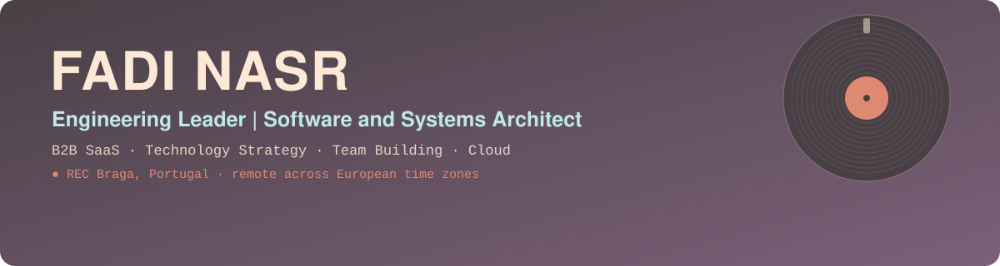
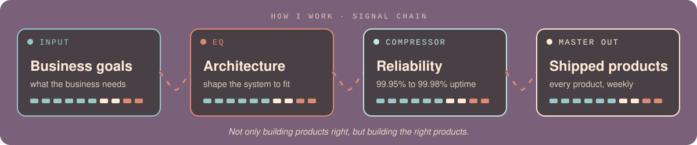
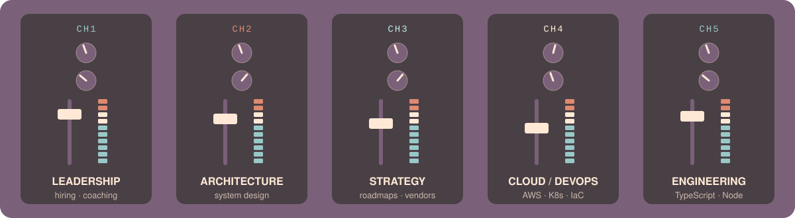

### Intro

I lead engineering teams, design the software and systems they build, and connect technology decisions to business goals. With a foundation in Computer Science, a Master's in Business Management and a love of clean architecture, I work at the intersection of technology, strategy and execution.

### Peak levels

| | |
|---|---|
| 🎚️ **10-person team** | Led 9 developers and a QA engineer on a B2B SaaS CRM used by about 5,000 companies |
| 🎧 **6 hires** | Assessed and hired 5 developers and the QA engineer, organized into cross-functional sub-teams |
| 📈 **99.98% uptime** | From two major outages a month to 99.95% in six months, then 99.98% after re-architecting on AWS |
| ☁️ **Cloud migration** | Led the move from DigitalOcean to AWS: architecture decision, design, provider and team |
| 🔁 **Weekly releases** | Every product, from micro-frontends to API and infrastructure |
| 🧩 **8+ client projects** | Led backend delivery and built an AWS CDK system for project infrastructure |

### Channels

| Channel | What's on it |
|---|---|
| **CH1 Leadership** | Technical recruiting, coaching and career growth, ownership models, incident processes, release management |
| **CH2 Architecture** | System design across serverless, modular, service-oriented and microservice systems; micro-frontends |
| **CH3 Strategy** | Strategic planning, technical roadmaps, stakeholder alignment, vendor decisions, migrations |
| **CH4 Cloud / DevOps** | AWS, AWS CDK, Terraform, Kubernetes, Helm, Argo CD, Docker, GitHub Actions, CircleCI, Sentry, OpenTelemetry |
| **CH5 Engineering** | TypeScript, Node.js, NestJS, React, Next.js, PostgreSQL, Prisma, MongoDB, Supabase |

### Now playing

<table>
<tr>
<td width="50%" valign="top">

**▶ FinSight**  
In development · Next.js · Supabase · Vercel

A financial decision-support platform for entrepreneurs that guides owners through their numbers: financial health, break-even, pricing and margins, cost structure, what-if scenarios and budgeting.

- Serverless architecture with authorization enforced at the database layer
- Calculation engine kept separate from the UI
- Configuration as code, CI/CD, documented architecture decisions

</td>
<td width="50%" valign="top">

**▶ DOWBUY**  
In development · Next.js · PostgreSQL · essentia.js

A track search and crate-curation tool for DJs: one query fans out to four music platforms and streams back merged results, one row per track.

- Phased, streaming search pipeline with caching and per-provider quotas
- In-browser audio analysis for BPM, key, loudness and energy
- Analysis moved to a Web Worker: main-thread blocking cut from about 934 ms to 0.4 ms per track

</td>
</tr>
</table>

### Setlist

| Years | Role | Where |
|---|---|---|
| 2023 to 2026 | **Technical Lead** | umsatz.io (B2B SaaS CRM), contract via uSoftware |
| 2021 to 2023 | **Senior Software Engineer** | Swenson He, remote, United States |
| 2020 to 2021 | **Tech Lead** | PotPay, retail-tech startup, Beirut |
| 2019 to 2021, 2023 to now | **Founder** | CodNovation, software services and products |
| 2016 to 2019 | **Full-stack developer** | Ampersand Holding, SOAJS, freelance |

### Patch in

Open to engineering leadership, software architecture, fractional tech lead and technology strategy roles,  
remote across European time zones or hybrid in Braga or Porto.

Off stage I'm <a href="https://sirqaf.com">Sir Qaf</a>, a DJ working on sonic branding, music production and sound design.

